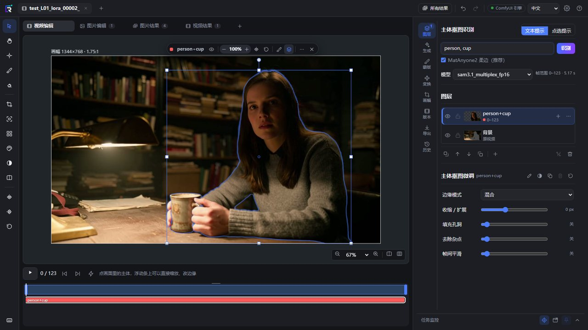
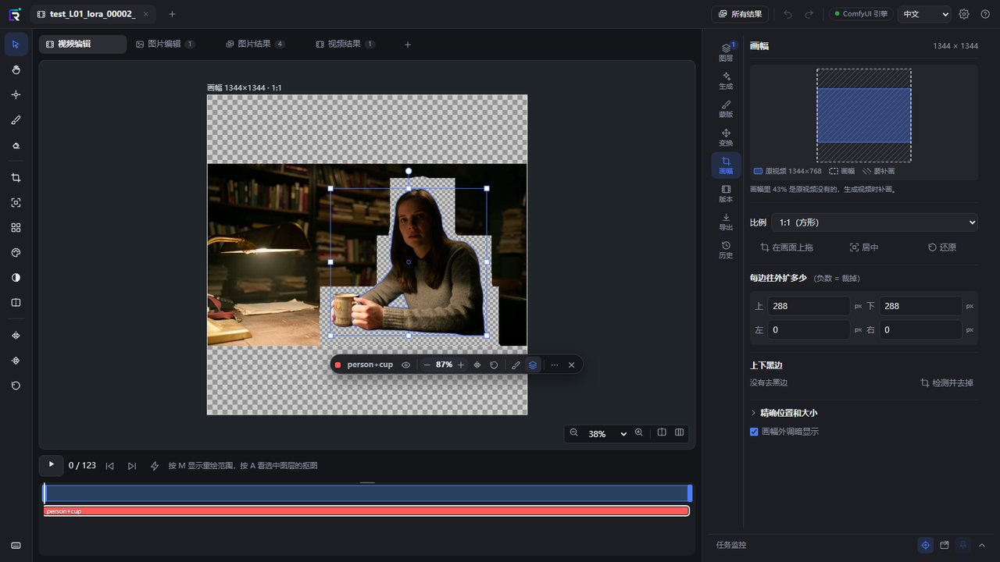
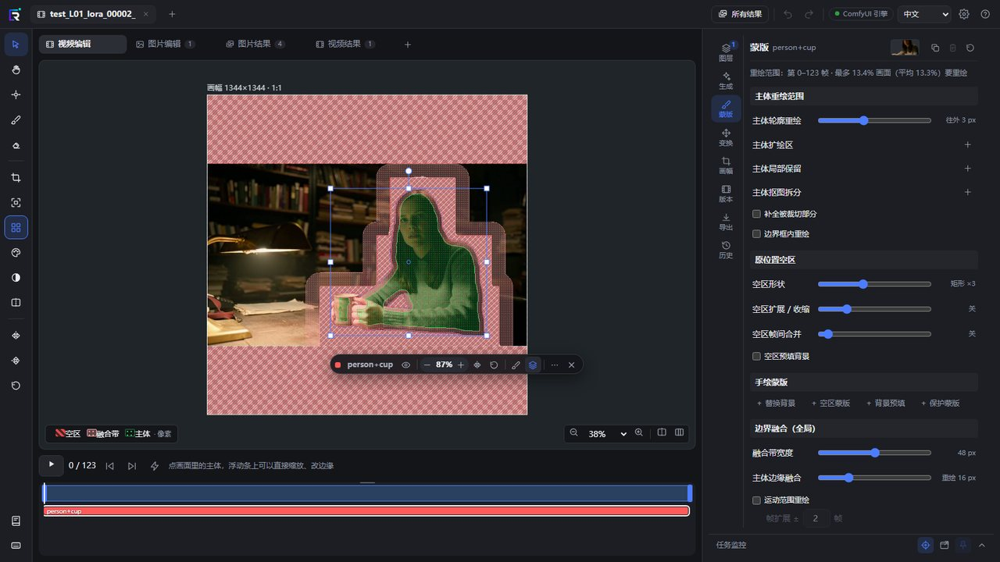
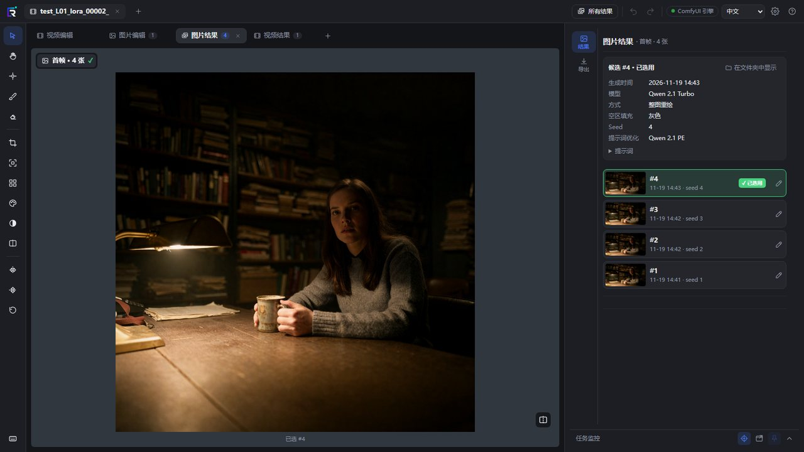
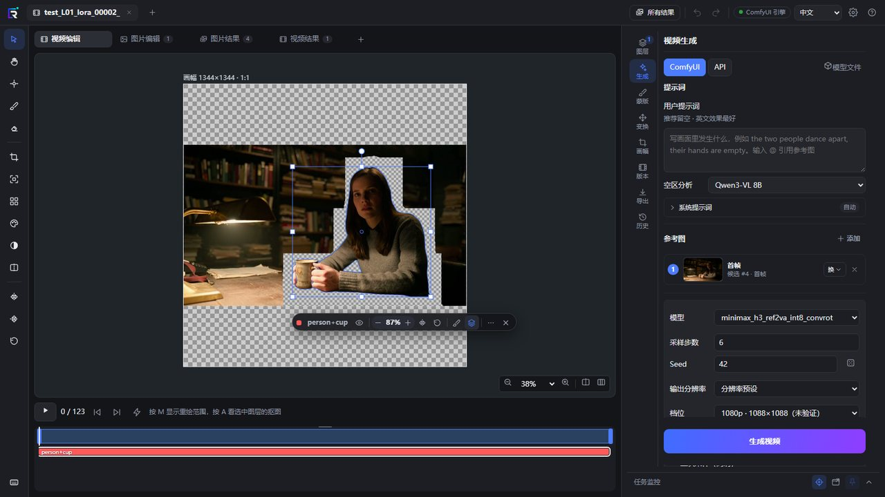
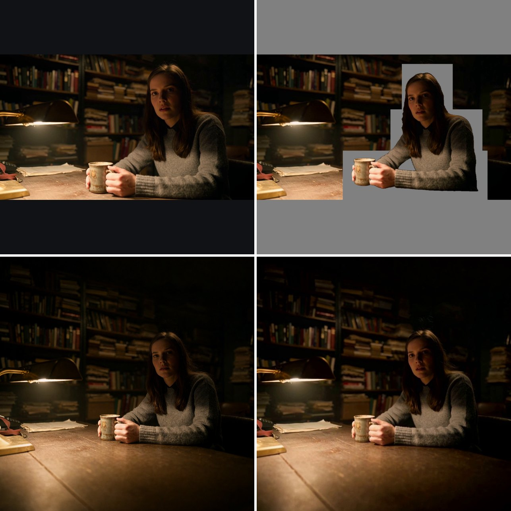

<p align="center"></p>

# ReFrameVideo

[English](README.md) · 中文 · [LoRA](https://huggingface.co/VoidEclipseAI/ReFrameVideo-LoRA) · [安装指南](docs/安装.md) · [新手教程](web/ui/tutorial-zh.md)

**开源的视频画面编辑与生成：自由改动画面里的一切。**

https://github.com/user-attachments/assets/8cbb910d-248c-41c0-be0c-d0c10e85afd0

<sub>宣传片中的画面来自电影片段，仅用于演示效果，版权归原作者所有。</sub>

ReFrameVideo 是一个个人制作的开源项目，用来自由修改已有视频的画面：移动、缩放、删除里面的人和物体，或者改变画幅，再由 AI 把整段视频重新生成出来。项目包括两部分：

- **视频编辑器**：使用 SAM 3.1 把视频中的元素转换成图层，然后像在 Photoshop 里一样自由编辑，并可以用参考图控制最终画面。
- **ReFrameVideo LoRA**：基于 MiniMax H3 训练，按你的编辑重新生成整段视频，自然补全编辑留下的空缺。

## 功能

- **识别主体**：输入文字或在画面上点选，把人和物体抠成图层（SAM 3.1，可选 MatAnyone2 抠出发丝等柔边）。
- **编辑画面**：移动、缩放、翻转、隐藏图层，扩展或裁切画幅，用蒙版控制哪里要重画；支持多版本和操作历史。
- **生成参考图**：按编辑后的画面生成首帧、背景图等参考图（Qwen Image 2.1 或 MiniMax H3 Image），挑一张最好的。
- **生成视频**：MiniMax H3 + ReFrameVideo LoRA 重新生成整段视频；长视频可以分段编辑。
- **扩展与导出**：可以换成自己的 ComfyUI 工作流或云端 API；每一步交给模型的素材和工作流都能导出。

## 快速开始

需要：Python 3.10+、[FFmpeg](https://ffmpeg.org/)（在 PATH 里）、一台装好 ComfyUI 的电脑（可以是本机）。

1. **配置 ComfyUI**：按 [安装指南](docs/安装.md) 装好模型；把 `comfyui/ComfyUI-Reframe/` 复制到 ComfyUI 的 `custom_nodes/`；把 ReFrameVideo LoRA（[Hugging Face](https://huggingface.co/VoidEclipseAI/ReFrameVideo-LoRA) / [ModelScope](https://modelscope.cn/models/VoidEclipseAI/ReFrameVideo-LoRA)）放进 `models/loras/`。
2. **下载并启动**：

   ```bash
   git clone https://github.com/VoidEclipseAI/ReFrameVideo.git
   cd ReFrameVideo
   ```

   Windows 双击 `start.bat`（第一次会自动装依赖）。Linux / macOS：

   ```bash
   python3 -m venv .venv
   .venv/bin/python -m pip install -r requirements.txt
   .venv/bin/python start.py
   ```

3. 第一次启动时输入 ComfyUI 地址（本机直接回车），浏览器会打开 `http://127.0.0.1:8765`。

## 使用教程：一个例子

一段 AI 生成的视频：女人坐在书桌前。把人和杯子一起缩小，再把横屏画幅扩成 1:1，让模型补出上下多出来的画面。下面的截图都来自这个项目。

**1. 识别**：点顶部「＋」导入视频。在「图层」面板输入 `person` 点「识别」，再输入 `cup` 识别一次。选中两个图层，合并成一个，让它们一起移动。



**2. 编辑**：把图层缩小到 87%；在「画幅」里把比例改成 1:1。棋盘格是空出来的地方（人原来的位置、画幅新增的上下两块），生成时由模型补画。



**3. 检查重绘范围**：按 `M` 查看哪里会重画：红色 = 补画，绿色 = 保留，深红 = 新旧画面之间的融合带。默认的「空区形状：矩形 ×3」把人形空洞改成方块，模型不容易照着轮廓再画出一个人。需要时在「蒙版」面板调整。



**4. 生成首帧**：点页面栏「＋」新建「首帧」，在「生成」面板点「生成候选」（一次 4 张），到「图片结果」选用最干净的一张。首帧决定成片的样子；不给也能生成，但给一张干净的首帧会稳定很多。



**5. 生成视频**：回到「视频编辑」，打开「生成」面板，确认参考图里有这张首帧，点「生成视频」。推荐 LoRA 强度 1.0，加 [Pika H3 Flex](https://huggingface.co/Pika-Labs/Pika-H3-Flex) 加速 LoRA 用 6 步，提示词可以留空。RTX 4090 上 5 秒的片段约 4–5 分钟，成片出现在「视频结果」里。



**结果**（左上到右下：原视频、粗剪（灰色 = 要补的空区）、选用的首帧、成片）：



成片视频（左：原视频，右：成片）：

https://github.com/user-attachments/assets/d0faf678-9df7-4419-8916-b3ce83fd1724

软件里左边栏的书本图标也能随时打开这份教程。更多用法（删掉一个人、换背景、长视频分段、导出到自己的 ComfyUI）见 [完整教程](web/ui/tutorial-zh.md)。

## 工作原理

ReFrameVideo 不做三维重建：由你决定物体放在哪、哪里可以改，模型参考原视频和参考图补出合理的结果。编辑器把编辑变成三样东西交给 MiniMax H3：

- **粗剪**：物体摆到新位置后的视频，空缺处涂成灰色；
- **蒙版**：逐帧标出哪里重画、哪里保留；
- **首帧**：最终画面应该的样子。

ReFrameVideo LoRA 让 H3 学会把灰色当成「要补的空缺」；不加它，H3 常常把灰色照抄下来。详见 [工作原理](docs/工作原理.md)。

## 已知限制

- **生成质量**：可能出现人物变形、多出物体、背景错误或帧间不一致；大幅移动、复杂遮挡时要仔细检查。
- **镜头运动**：测试主要是固定机位、慢摇和跟拍。快速甩镜、绕拍、大幅推拉变焦等大幅镜头运动没有充分测试，效果可能明显变差；而且编辑按画面位置摆放，镜头大幅运动时挪过的物体可能不跟着场景走。
- **画面风格**：LoRA 只用真人实拍素材训练，对动画、卡通、三维渲染效果可能较弱。
- **保留区域**：成片用模型输出的整幅画面，不把原视频逐像素贴回，保留区域可能有细微差异。
- **安全**：后端只给本机浏览器用，没有登录和权限管理，不要暴露到公网。
- **平台**：只在 Windows 上完整测试过。
- **为什么编辑器不做进 ComfyUI**：编辑要在画面上拖动图层、逐帧检查蒙版、在时间轴上调帧范围、反复预览，这些交互放进 ComfyUI 的节点图里很难用，所以做成了独立的编辑器，ComfyUI 只负责运行模型。每一步交给模型的素材（粗剪、蒙版、参考图、提示词）和 `workflow_api.json` 都可以用「导出」打包下载，在你自己的 ComfyUI 工作流里直接生成。示例：[workflows/ReFrameVideo_H3_example_workflow_api.json](workflows/ReFrameVideo_H3_example_workflow_api.json) 是上面教程例子那次成片用的工作流。

## 反馈与支持

ReFrameVideo 由我一个人开发。构想、LoRA 训练、交互设计和测试由我完成，代码和文档在 AI 编程助手（Claude Code）协助下编写。

- **反馈**：欢迎通过 Issue 反馈问题或提需求，请附上复现步骤和日志。
- **赞助 / 算力**：可以在 [Ko-fi](https://ko-fi.com/voideclipseai) 支持，主要用于训练算力。下一版 LoRA 计划支持人物和物品替换、任意关键帧参考、多种画面风格，如果你能提供 GPU 算力，欢迎联系。
- **合作**：欢迎集成、定制开发或研究合作。

联系方式：邮箱 voideclipseai@gmail.com · 微信 voideclipseai

## 致谢

ReFrameVideo 建立在这些开源项目和模型之上，感谢它们的作者：

- [MiniMax H3](https://huggingface.co/MiniMaxAI/MiniMax-H3)、[MiniMax H3 Image](https://huggingface.co/MiniMaxAI/MiniMax-H3-Image)（MiniMax）：视频生成和改图模型，ReFrameVideo LoRA 的基础模型。
- [ComfyUI](https://github.com/Comfy-Org/ComfyUI)：所有模型都在 ComfyUI 里运行；也感谢 Comfy-Org 整理的 [MiniMax H3](https://huggingface.co/Comfy-Org/MiniMax-H3) 等模型文件。
- [Pika H3 Flex](https://huggingface.co/Pika-Labs/Pika-H3-Flex)（Pika）：加速 LoRA，6 步出片。
- [SAM 3](https://github.com/facebookresearch/sam3)（Meta）：识别和分割主体。
- [Qwen Image](https://github.com/QwenLM/Qwen-Image)、[Qwen3-VL](https://github.com/QwenLM/Qwen3-VL)（通义千问 Qwen 团队）：生成参考图、看图写提示词。
- [MatAnyone 2](https://github.com/pq-yang/MatAnyone2) 和 ComfyUI 节点 [ComfyUI-MatAnyone](https://github.com/FuouM/ComfyUI-MatAnyone)：抠出发丝等柔边。
- [FFmpeg](https://ffmpeg.org/)、FastAPI、OpenCV、NumPy 等开源库。

## 许可

Copyright © 2026 VoidEclipseAI

- **ReFrameVideo**（含 `comfyui/ComfyUI-Reframe/` 节点包）：[GNU AGPL-3.0](LICENSE)。可以免费使用、修改和商用；分发修改版或把修改版做成网络服务时，要按 AGPL-3.0 公开源代码。
- **商业许可**：不想受 AGPL-3.0 约束（例如闭源集成到自己的产品）时，可以联系获取：邮箱 voideclipseai@gmail.com · 微信 voideclipseai
- **模型**：本仓库不含任何模型。ReFrameVideo LoRA 是 MiniMax H3 的衍生模型，遵循 MiniMax H3 Community License Agreement；其他模型遵循各自的许可，使用前请自行确认。第三方提示词的来源见 [app/prompts/THIRD_PARTY.md](app/prompts/THIRD_PARTY.md)。
